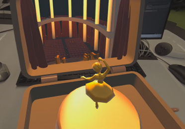
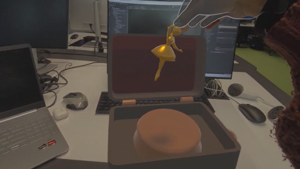

# Hidden World — A Mixed Reality Music Box

*What if ordinary objects were hiding extraordinary worlds, waiting to be discovered?*

**[▶ Watch Demo](https://drive.google.com/file/d/140AbWZqfqZhUQyHVaxCoxVzSpDnFIVxc/view?usp=sharing)**

## About the Project

**Hidden World** is a mixed reality experience inspired by magical realism: the idea that the ordinary and the extraordinary can coexist, and that even the most familiar objects might conceal an unexpected world.

At first glance, it is just an old music box, with a missing ballerina and an empty pedestal. But behind its lid lies a secret theatre, where the little ballerina performs in front of an audience, fulfilling her dream with every spin.

To discover this hidden world, the user must first pick up the fallen ballerina and return her to her place. Only then can the music box be wound up, revealing the theatre through opening curtains, moving spotlights, music, and the ballerina's performance.

The experience plays with the contrast between a small, familiar object and the much larger world concealed within it, inviting the user to discover the extraordinary through simple, physical interactions.

## Behind the Experience

Developed in **Unity for Meta Quest 3**, the project uses mixed reality passthrough to place the music box directly into the user's physical surroundings.

The experience combines Meta XR hand interactions with custom C# scripts implementing:

- **Object manipulation and snapping:** Grabbing the ballerina, detecting its proximity to the pedestal, and automatically aligning it into place.
- **Mechanical interaction:** A winding handle with constrained rotation, enabled only after the ballerina has been positioned.
- **Interaction logic:** Coordinating the two actions to trigger the hidden performance.
- **Animation sequencing:** Using Unity Timeline to synchronize the curtains, ballerina rotation, lighting, and spatialized audio.

### Creating the World

All 3D models were created from scratch in **Blender**, including the music box, ballerina, theatre architecture, curtains, and orchestra instruments. The curtain animations were also created in Blender and imported into Unity.

Materials were built directly in Unity, using a warm palette of red, gold, and cream, while lighting and particle effects helped bring the miniature theatre to life.

The visual environment and custom interaction logic were developed specifically for this project, without AI-generated assets or pre-made 3D models. Existing XR frameworks and externally sourced audio were used where appropriate.

## Technologies

**Development:** Unity · C# · Meta XR SDK v72 · OpenXR

**Interaction & Animation:** Meta XR Interaction SDK · Unity Timeline

**3D Creation:** Blender · Unity Materials & Particle Systems

**Hardware:** Meta Quest 3

## Credits & References

All 3D assets, materials, and custom interaction scripts were created for this project. External resources were used for audio and learning, along with visual inspiration.

### Audio

The following recordings were sourced from [Freesound](https://freesound.org/) and are available under the Creative Commons CC0 license:

- **Music box winding sound:** [music box - wind up 06.wav](https://freesound.org/people/Anthousai/sounds/336609/) — Anthousai (2016).
- **Music box performance:** [Music Box - Magic Flute, Mozart.wav](https://freesound.org/people/pooky1/sounds/432152/) — pooky1 (2018).

### Blender Learning Resources

The following tutorials were consulted during the modelling and animation process:

- **PIXXO 3D** — [Blender: Rig a Character from Scratch | CLEAR BEGINNERS GUIDE](https://www.youtube.com/watch?v=eCtSviaHZ6U)
- **PIXXO 3D** — [Blender MODELLING for Absolute Beginners | Low Poly Girl](https://www.youtube.com/watch?v=sbCW0Cs7aI8)
- **PIXXO 3D** — [Curtain Animations Are EASY | Blender Tutorial | Open & Close](https://www.youtube.com/watch?v=qFyEMX6Ez7A)

---

*Individual university project developed for a Virtual Reality unit at Monash University, Australia — 2026.*